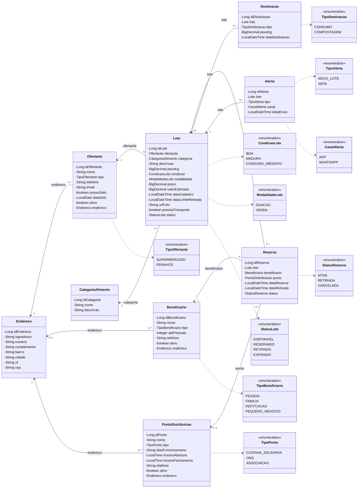
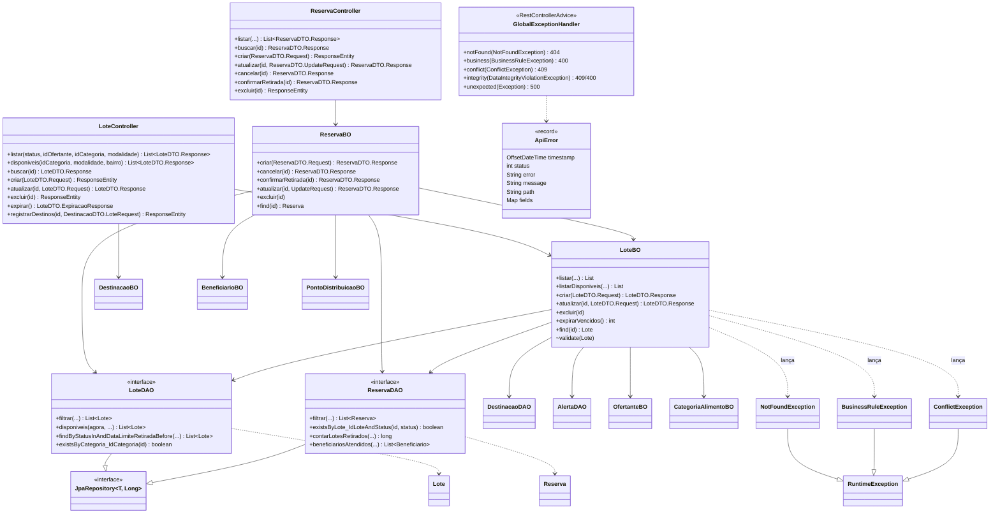

# Rede de Prato — Diagrama de classes (código Java)

Gerado a partir das classes em `src/main/java/br/com/fiap/redeprato`. Os atributos e tipos são exatamente os do código. Cada chave estrangeira é um atributo do tipo da outra classe (não um `Long` solto), então o diagrama corresponde ao DER (`docs/der.md`).

## 1. Modelo (pacote `entity` e `entity.enums`)

Observações de mapeamento:
- `boolean` ↔ `CHAR(1)` 'S'/'N' via `converter.BooleanSNConverter`; `LocalTime` ↔ `VARCHAR2(5)` "HH:MM" via `converter.LocalTimeHHMMConverter`.
- Todos os relacionamentos são `@ManyToOne(fetch = LAZY)` (navegação do filho para o pai); listas de filhos são consultadas pelos DAOs.
- Lombok: `@Getter @Setter @NoArgsConstructor @AllArgsConstructor @Builder` em todas as entidades.

## 2. Camadas (Controller → BO → DAO → Entity) e exceções

O mesmo padrão vale para os outros recursos:

| Controller (`/api/...`) | BO | DAO | Entidade |
| --- | --- | --- | --- |
| `CategoriaController` (`/categorias`) | `CategoriaAlimentoBO` | `CategoriaAlimentoDAO` | `CategoriaAlimento` |
| `EnderecoController` (`/enderecos`) | `EnderecoBO` | `EnderecoDAO` | `Endereco` |
| `OfertanteController` (`/ofertantes`) | `OfertanteBO` | `OfertanteDAO` | `Ofertante` |
| `LoteController` (`/lotes`) | `LoteBO`, `DestinacaoBO` | `LoteDAO` | `Lote` |
| `BeneficiarioController` (`/beneficiarios`) | `BeneficiarioBO` | `BeneficiarioDAO` | `Beneficiario` |
| `PontoController` (`/pontos`) | `PontoDistribuicaoBO` | `PontoDistribuicaoDAO` | `PontoDistribuicao` |
| `ReservaController` (`/reservas`) | `ReservaBO` | `ReservaDAO` | `Reserva` |
| `DestinacaoController` (`/destinacoes`) | `DestinacaoBO` | `DestinacaoDAO` | `Destinacao` |
| `AlertaController` (`/alertas`) | `AlertaBO` | `AlertaDAO` | `Alerta` |
| `ImpactoController` (`/impacto`) | `ImpactoBO` | `DestinacaoDAO`, `ReservaDAO` | (consultas agregadas) |
| `RelatorioController` (`/relatorios`) | `RelatorioBO` | `DestinacaoDAO` | (relatório mensal) |
| `HealthController` (`/health`) | — | — | — |

Apoio: `dto` (records `XxxDTO.Request` / `XxxDTO.Response`), `converter` (S/N e HH:MM), `config` (`ClockConfig`, `WebConfig`, `ExpiracaoJob`, `DataSeeder`).
