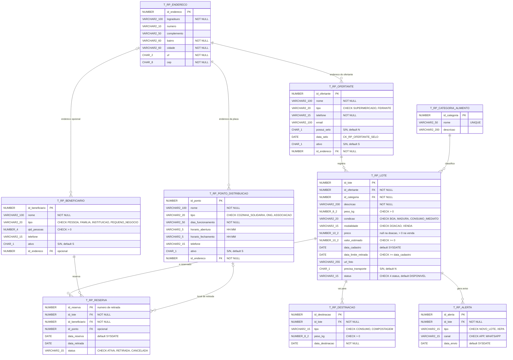

# Rede de Prato — DER (modelo do banco)

> O DER oficial é o diagrama do **Oracle Data Modeler** feito pela Mariana Souza França (Database Design), junto com o DDL em `db/`. Este diagrama em Mermaid foi feito a partir de `docs/classes.md` e das anotações das entidades Java, para conferir que o código bate com o banco.



(Mermaid não aceita parênteses nem vírgulas no tipo: `VARCHAR2_100` = `VARCHAR2(100)`, `NUMBER_8_2` = `NUMBER(8,2)`, `CHAR_1` = `CHAR(1)`.)

## Restrições extras (do DDL)

```sql
-- Só uma reserva ATIVA por lote (decisão 3) → ORA-00001 vira 409 na API
CREATE UNIQUE INDEX UX_RP_RESERVA_ATIVA_LOTE
  ON T_RP_RESERVA (CASE WHEN status = 'ATIVA' THEN id_lote END);

-- Selo e data andam juntos (decisão 7)
ALTER TABLE T_RP_OFERTANTE ADD CONSTRAINT CK_RP_OFERTANTE_SELO
  CHECK ( (possui_selo = 'S' AND data_selo IS NOT NULL) OR (possui_selo = 'N' AND data_selo IS NULL) );
```

## Cardinalidades

| De | Para | Cardinalidade | FK |
| --- | --- | --- | --- |
| Endereço | Ofertante | 1 : 0..N | `T_RP_OFERTANTE.id_endereco` |
| Endereço | Beneficiário | 0..1 : 0..N | `T_RP_BENEFICIARIO.id_endereco` (opcional) |
| Endereço | Ponto de distribuição | 1 : 0..N | `T_RP_PONTO_DISTRIBUICAO.id_endereco` |
| Ofertante | Lote | 1 : 0..N | `T_RP_LOTE.id_ofertante` |
| Categoria | Lote | 1 : 0..N | `T_RP_LOTE.id_categoria` |
| Lote | Reserva | 1 : 0..N (só 1 ATIVA) | `T_RP_RESERVA.id_lote` |
| Beneficiário | Reserva | 1 : 0..N | `T_RP_RESERVA.id_beneficiario` |
| Ponto | Reserva | 0..1 : 0..N | `T_RP_RESERVA.id_ponto` (opcional) |
| Lote | Destinação | 1 : 0..N | `T_RP_DESTINACAO.id_lote` |
| Lote | Alerta | 1 : 0..N | `T_RP_ALERTA.id_lote` |
